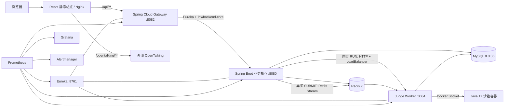

# AInterview 全栈技术栈与项目面试问答

> 生成日期：2026-08-28  
> 适用项目：`D:\Ainterview` 当前工作区  
> 取证基线：根/模块 `pom.xml`、`frontend-react/package.json`、各模块 `application.yml`、`docker-compose.yml`、Dockerfile、Nginx、Flyway V1/V9–V47、关键业务代码与测试目录。  
> 使用原则：本文只把当前源码和配置中已存在的能力写成“已使用”；外部 Provider、ClamAV、监控 profile 等依赖部署环境的能力会明确标注为“可选或需运行环境验证”。

## 目录

1. [项目定位与一段话介绍](#1-项目定位与一段话介绍)
2. [技术栈总表](#2-技术栈总表)
3. [Java 17 与 Maven 多模块](#3-java-17-与-maven-多模块)
4. [Spring Boot、Spring MVC 与接口工程化](#4-spring-bootspring-mvc-与接口工程化)
5. [Spring Security、JWT 与账户安全](#5-spring-securityjwt-与账户安全)
6. [MySQL、MyBatis-Plus 与 Flyway](#6-mysqlmybatis-plus-与-flyway)
7. [Redis：限流、验证码与消息流](#7-redis限流验证码与消息流)
8. [Spring Cloud：Eureka、Gateway 与 LoadBalancer](#8-spring-cloudeurekagateway-与-loadbalancer)
9. [AI、DeepSeek、Prompt 与模型治理](#9-aideepseekprompt-与模型治理)
10. [异步任务、线程池、幂等与并发控制](#10-异步任务线程池幂等与并发控制)
11. [算法判题 Worker 与 Docker 沙箱](#11-算法判题-worker-与-docker-沙箱)
12. [文件、私有媒体、PDF 与 DOCX](#12-文件私有媒体pdf-与-docx)
13. [OpenTalking、WebRTC、TTS/STT 与录制](#13-opentalkingwebrtcttsstt-与录制)
14. [React 19、TypeScript 与前端工程化](#14-react-19typescript-与前端工程化)
15. [Docker Compose、Nginx 与交付](#15-docker-composenginx-与交付)
16. [可观测性、审计与故障定位](#16-可观测性审计与故障定位)
17. [测试、CI 与质量门禁](#17-测试ci-与质量门禁)
18. [综合项目面试题与回答模板](#18-综合项目面试题与回答模板)
19. [面试前速记清单](#19-面试前速记清单)

## 1. 项目定位与一段话介绍

### 1.1 项目是什么

AInterview 是一个多模态智能模拟面试与招聘协同平台。候选人可以完成文字、语音、视频面试，获得 AI 追问、评分、报告和训练建议；也可以维护简历、投递岗位、参加算法练习、阅读私有学习资料。企业用户可以管理岗位、申请、面试、人才库和招聘分析；平台管理员负责用户、企业、权限、AI Provider、Prompt、模型调用、治理评测、工单、审计和运行健康。

### 1.2 当前真实架构

项目采用“模块化单体业务核心 + 最小 Spring Cloud 基础设施 + 独立算法判题 Worker”的渐进式架构，不应在面试中直接说成“完整微服务系统”。



### 1.3 四个 Maven 模块

| 模块 | 职责 | 关键边界 |
|---|---|---|
| `backend` | 认证、账户、面试、AI、招聘、报告、媒体、工单、通知、学习资料、算法 API | 模块化单体；执行 Flyway；不挂 Docker Socket |
| `algorithm-judge-worker` | Redis Stream 消费、判题抢占、Docker 沙箱、结果落库 | 唯一允许访问 Docker Socket 的应用服务 |
| `cloud-gateway` | `/api/**` 统一入口、Eureka 服务发现与负载均衡转发 | 不持久化业务数据，不负责 JWT 最终授权 |
| `cloud-registry` | Eureka 服务注册中心 | 不承载业务接口和数据库迁移 |

### 1.4 面试题：请用 1 分钟介绍项目

**参考回答：**

我做的是 AInterview 多模态智能模拟面试与招聘协同平台。它同时服务候选人、企业 HR 和平台管理员，核心链路包括面试创建与恢复、AI 追问和评分、报告生成、简历解析与岗位匹配、企业招聘流程，以及 Java 算法在线判题。

架构上没有为了“微服务”而过度拆分。大部分业务放在 Spring Boot 4.0.7 的模块化单体中，统一事务和权限边界；公共入口使用 Spring Cloud Gateway 和 Eureka；高风险、资源消耗明显的算法判题被拆成独立 Worker，并通过 Redis Stream 和 Docker 沙箱执行。前端使用 React 19、TypeScript、Vite 和 Tailwind CSS 4，生产通过 Nginx 提供同源 API、OpenTalking 和 Grafana 代理。数据使用 MySQL 8 和 Flyway 管理版本，Redis 负责验证码、限流协调和判题消息流，监控使用 Actuator、Micrometer、Prometheus、Alertmanager 与 Grafana。

项目中我重点解决了三类问题：第一是 JWT、RBAC、企业租户和资源归属的多层权限；第二是 AI 任务幂等、租约恢复、Prompt 版本与模型治理；第三是判题沙箱的隔离、超时、并发、重复消费和故障恢复。

### 1.5 面试题：为什么不是把所有业务都拆成微服务

**参考回答：**

业务拆分的收益必须大于分布式复杂度。账户、面试、报告、招聘申请等领域之间存在较多强事务和聚合查询，如果过早拆分，会立刻引入分布式事务、数据一致性、链路追踪、接口版本和运维成本。当前团队和规模下，模块化单体能保留清晰包边界，同时让强一致写入继续使用本地事务。

判题 Worker 是例外，因为它需要 Docker Socket、CPU/内存限制和独立扩缩容，安全边界与资源模型和普通 API 完全不同，所以单独拆分最有价值。Gateway 和 Eureka 则为后续增量拆分提供统一入口和发现机制。这是一种“先按风险和资源边界拆，再按业务压力演进”的方案。

### 1.6 面试题：项目最值得讲的三个技术亮点是什么

**参考回答：**

第一，认证不是只有一个 JWT Filter，而是短期 Access Token、可轮换 Refresh Token、`securityVersion`、`sessionId`、设备会话撤销、服务端 `/v1/auth/me` 权威身份和方法级资源授权组成的完整链路。

第二，AI 不是一次同步 HTTP 调用。项目有版本化 Prompt、数据库 Provider 热切换、生成审计、MySQL AI 任务租约、心跳、去重键、失败恢复，并为招聘 AI 增加脱敏、评测门禁、预算预留、紧急停用和人工复核。

第三，算法判题把 Docker 能力隔离到独立 Worker。同步 RUN 走内部 HTTP，正式 SUBMIT 走 Redis Stream；Worker 使用数据库条件抢占保证幂等，容器禁网、限制 CPU/内存/PID、丢弃 Linux capabilities，并用 tar 归档传输输入输出，不使用 `docker exec`。

## 2. 技术栈总表

### 2.1 后端与服务治理

| 技术 | 当前版本/来源 | 项目用途 |
|---|---:|---|
| Java | 17 | 四个后端模块与 Java 判题语言基线 |
| Maven | 3.9.x 构建镜像 | 聚合四模块、依赖管理、测试、打包 |
| Spring Boot | 4.0.7 | Web、配置、依赖注入、Actuator、测试 |
| Spring MVC | Boot Starter Web | 业务 REST API |
| Spring WebFlux | Gateway Starter | Reactive Gateway 路由 |
| Bean Validation | Boot Starter Validation | DTO 参数校验 |
| Jackson 2/3 兼容配置 | Boot 管理 | JSON 序列化；Long 统一序列化为字符串 |
| Springdoc OpenAPI | 3.0.3 | OpenAPI 与 Swagger UI |
| Spring Security | Boot 管理 | 无状态认证、方法级权限、BCrypt |
| JJWT | 0.12.6 | JWT 签发和验签 |
| Spring Cloud | 2025.1.2 | Eureka、Gateway、LoadBalancer |
| Spring Cloud CircuitBreaker | 5.0.2 | Resilience4j 集成 |
| Resilience4j | BOM 管理 | 判题 Worker 熔断 |
| Lombok | 1.18.34 | Java 样板代码简化 |

### 2.2 数据与中间件

| 技术 | 当前版本/镜像 | 项目用途 |
|---|---:|---|
| MySQL | 8.0.36 | 核心业务、任务、审计与判题数据 |
| MyBatis-Plus | 3.5.17 | Mapper、条件构造、分页与常规 CRUD |
| JSqlParser 扩展 | 3.5.17 | MyBatis-Plus 分页所需 |
| Flyway | Boot 4 依赖管理 | 唯一数据库迁移机制，当前 40 个脚本，最高 V47 |
| Redis | `redis:7-alpine` | 限流、验证码、一次性票据、Redis Stream |
| Redis AOF | Compose 启用 | 提高 Redis 重启后的数据恢复能力 |

### 2.3 AI、外部服务与文件

| 技术 | 当前版本/实现 | 项目用途 |
|---|---:|---|
| DeepSeek 兼容 Chat Completions | 数据库 Provider 优先，环境变量兜底 | 追问、评分、报告、简历解析、岗位匹配 |
| JDK `HttpClient` | Java 17 | 大模型 HTTP 调用 |
| Spring `RestClient` | Boot 4 | 短信、Provider 检查、内部 Worker 调用 |
| JavaMailSender / SMTPS | Boot Mail | 邮箱验证码与通知 |
| 阿里云市场短信接口 | 外部服务 | 短信验证码 |
| Apache PDFBox | 3.0.3 | PDF 简历文本解析 |
| Apache POI OOXML | 5.3.0 | DOCX 简历解析 |
| Commons Lang | 3.17.0 | Java 字符串等通用工具 |
| ClamAV INSTREAM | 可选 | 上传文件同步病毒扫描 |
| OpenTalking | 外部服务 | 数字人会话、WebRTC 媒体、TTS/STT |
| Web Speech API | 浏览器能力 | OpenTalking 不可用时的朗读降级 |
| MediaRecorder | 浏览器能力 | 按题录制 WebM 音视频 |

### 2.4 前端

| 技术 | `package.json` 当前声明 | 项目用途 |
|---|---:|---|
| React / React DOM | 19.2.8 | SPA、组件与并发 UI 基础 |
| TypeScript | 5.8.3 | 静态类型、接口模型与构建校验 |
| Vite | 7.0.6 | 开发服务器、构建、分包和代理 |
| React Router DOM | 7.18.2 | 公开、候选人、企业和管理员路由 |
| Tailwind CSS | 4.1.11 | 原子样式、响应式布局和主题 Token |
| Radix Dialog | 1.1.15 | 可访问对话框与移动抽屉 |
| Framer Motion | 12.23.12 | 页面和局部过渡，支持减少动态效果 |
| Lucide React | 0.468.0 | 统一业务语义图标 |
| Monaco Editor | 0.56.0 | Java 算法编辑器，按需加载 |
| PDF.js | 6.2.108 | 浏览器 PDF 页面和文本层渲染 |
| React Markdown | 10.1.0 | Markdown 内容渲染 |
| `clsx` / `tailwind-merge` | 2.1.1 / 3.3.0 | 条件 class 与 Tailwind class 合并 |
| Playwright | 1.62.1 | Chromium 端到端回归 |
| ESLint / Prettier | 10.8.0 / 3.9.6 | 静态检查与格式化 |

### 2.5 容器、网关与监控

| 技术 | 当前版本/镜像 | 项目用途 |
|---|---:|---|
| Docker / Docker Compose | Compose v2 语法 | 本地与基础部署编排 |
| Nginx | 1.27-alpine | SPA、同源反向代理、缓存策略 |
| Eclipse Temurin | Java 17 JDK/JRE | 编译、后端运行、判题 Runner |
| Node.js | 22.13-alpine | 前端生产构建 |
| Spring Boot Actuator | Boot 4.0.7 | 健康、信息与 Prometheus 端点 |
| Micrometer Prometheus Registry | Boot 管理 | 应用和业务指标 |
| Prometheus | 2.55.1 | 指标采集与规则计算 |
| Alertmanager | 0.27.0 | 告警聚合与路由基础 |
| Grafana | 11.3.0 | 运行监控面板 |
| GitHub Actions | `quality.yml` | 后端、前端、Compose 质量门禁 |

### 2.6 声明了但当前源码没有直接使用的依赖

当前 `package.json` 声明了 `class-variance-authority` 和 `mpegts.js`，但对 `frontend-react/src` 的直接导入扫描为 0。面试时不要把它们说成当前核心实现：可以表述为“依赖清单中保留，但当前源码主链路没有直接引用，后续应确认后删除或重新接入”。

### 2.7 当前项目明确没有使用什么

- 没有使用 JPA/Hibernate，数据访问以 MyBatis-Plus 和自定义 SQL 为主。
- 没有使用 Redux、Zustand 或 React Query；当前主要使用 React Context、Hooks 和封装后的原生 `fetch`。
- 没有使用 Kafka、RabbitMQ；AI 任务主要在 MySQL 中调度，算法提交使用 Redis Stream。
- 没有使用 MongoDB；核心持久化是 MySQL。
- 没有使用 Kubernetes；当前交付基线是 Docker Compose。
- 历史 Vue 前端不属于当前仓库运行基线。
- `avatar-skill` 和讯飞虚拟人链路未进入当前运行结构，唯一保留链路是 OpenTalking。

## 3. Java 17 与 Maven 多模块

### 3.1 在项目中的使用

Java 17 是后端和判题 Runner 的统一语言基线。项目代码使用了 `record`、文本块、增强 `switch`、模式匹配 `instanceof`、`java.net.http.HttpClient`、`CompletableFuture` 和显式线程池。根 `pom.xml` 只做 Maven Reactor 聚合，四个子模块分别继承 Spring Boot Parent，并通过 Spring Cloud BOM 管理兼容版本。

### 3.2 为什么 Maven 要做四模块聚合

- 根工程可以统一执行 Reactor 编译和测试。
- 每个服务拥有独立依赖与 Docker 构建上下文，避免 Gateway 或 Registry 引入业务依赖。
- 判题 Worker 可以独立发布、扩容和收紧权限。
- 业务核心仍保留单体事务，不因 Maven 多模块而假装已经完成业务微服务化。

### 3.3 面试题：为什么选择 Java 17

**参考回答：**

Java 17 是 LTS 版本，生态成熟，和 Spring Boot 4 当前配置兼容。项目中既需要稳定的 Spring 生态，也需要较新的语言能力。比如统一响应和分页对象使用 `record` 能减少只读 DTO 样板代码；AI Prompt 使用文本块可读性更高；增强 `switch` 适合文件 MIME 到扩展名的安全映射；JDK `HttpClient` 足以完成 DeepSeek 的超时和请求处理，不必为单个调用再引入客户端框架。

选择版本时我更看重 LTS、依赖兼容和运行镜像一致性，而不是单纯追新。项目的编译镜像、JRE 镜像和判题 Runner 都固定在 Java 17，降低了“本地能跑、容器不能跑”的环境漂移。

### 3.4 面试题：`CompletableFuture` 在项目里怎么用，有什么风险

**参考回答：**

报告生成时，多道主观题的模型评分相互独立，所以使用 `CompletableFuture.supplyAsync` 在专用 `reportScoringExecutor` 中并发执行，再通过 `allOf(...).join()` 汇合，最后生成汇总报告。默认评分并发为 3，因此 5 道题从 5 次串行等待缩短为最多两批评分等待。

风险主要有三个：不能使用公共 ForkJoinPool，否则 AI 慢调用可能影响全局任务；并发数和队列必须有界，否则上游慢时会堆积内存；异常需要在汇合点统一转换并更新任务状态。当前项目使用独立、固定大小线程池和有限队列，并把任务状态持久化，避免只在内存里“发出去就不管”。

### 3.5 面试题：为什么线程池拒绝策略使用 `CallerRunsPolicy`

**参考回答：**

AI 任务不能静默丢弃。`CallerRunsPolicy` 在队列满时让提交任务的线程执行，形成自然背压，能够减缓继续取任务的速度，同时保留任务执行机会。它的代价是调用线程可能被占用，所以不能把它放在延迟敏感的用户请求链路上。当前主要用于后台 AI 执行器，且队列、线程数和调度批次都有上限。

如果未来吞吐显著增加，我会把模型任务迁移到独立消息队列和 Worker，并使用明确的消费者并发、重试和死信策略，而不是继续扩大单 JVM 线程池。

### 3.6 面试题：Maven Parent 和 BOM 有什么区别

**参考回答：**

Parent 除了依赖版本，还能继承插件、默认属性和构建配置；BOM 主要通过 `dependencyManagement` 约束一组依赖版本，不会把依赖自动加入项目。当前各服务使用 `spring-boot-starter-parent:4.0.7`，同时导入 `spring-cloud-dependencies:2025.1.2`，backend 还导入 CircuitBreaker BOM。这样 Starter 和 Cloud 组件的版本由官方兼容矩阵管理，减少手工组合冲突。

## 4. Spring Boot、Spring MVC 与接口工程化

### 4.1 后端分层

```text
Controller  →  HTTP、DTO、@Valid、ApiResponse
Service     →  权限后的业务规则、状态机、事务、幂等
Mapper      →  MyBatis-Plus 与自定义 SQL
Domain      →  数据表实体
Config      →  Security、Flyway、JSON、线程池、限流、上传配置
```

项目有统一 `ApiResponse<T>`，返回 `code`、`message`、`data`、`requestId` 和时间；分页使用独立 `PageResult<T>`，不把 ORM 的分页对象直接暴露给前端。`RequestIdFilter` 接收或生成 `X-Request-Id`，写入 MDC 和响应头。`GlobalExceptionHandler` 把业务异常、参数校验、403、405 和未知异常转换为安全响应，未知异常只向客户端返回通用文案。

### 4.2 关键接口技术

- Spring MVC `@RestController` 处理业务 API。
- Jakarta Bean Validation 配合 `@Valid` 完成必填、长度、格式和范围校验。
- Springdoc 暴露 `/v3/api-docs` 和 Swagger UI。
- Jackson 将 Java `Long` 统一序列化为字符串，避免 Snowflake ID 超过 JavaScript 安全整数范围。
- 管理端数据字典通过 JDBC `DatabaseMetaData` 读取表、列、索引和约束元数据，不读取业务行，也不接受客户端 SQL。

### 4.3 面试题：为什么 Controller 要保持轻量

**参考回答：**

Controller 的职责是协议适配：接收请求、校验 DTO、取认证上下文并返回统一响应。事务、状态流转、幂等和资源归属应该放在 Service。这样同一业务规则可以被 HTTP、定时任务和内部任务复用，也便于针对 Service 做单元测试。

如果把 SQL 和状态机放进 Controller，会导致事务边界分散、异常响应不统一，也容易出现某个入口做了权限校验、另一个入口遗漏的情况。AInterview 中企业资源跨租户校验、申请状态机和报告发布都集中在服务层，Controller 上的方法权限只是第一道门。

### 4.4 面试题：统一响应体有什么价值，HTTP 状态码还要不要

**参考回答：**

统一响应体方便前端稳定读取业务码、消息、数据和 `requestId`，特别是排障时可以把浏览器错误和服务端日志关联起来。但它不能替代 HTTP 语义。项目仍使用 400、401、403、404、409、429、500、503 等真实状态码，响应体再提供细分业务码。

如果所有失败都返回 HTTP 200，网关、监控、浏览器和客户端重试都会失去标准语义；如果只返回 HTTP 状态而没有业务码，复杂表单和状态冲突又不够精确。因此两者应同时保留。

### 4.5 面试题：为什么把 Long ID 序列化成字符串

**参考回答：**

后端部分 ID 使用 Snowflake 风格的 64 位整数，而 JavaScript `Number` 的安全整数上限是 `2^53 - 1`。如果直接返回 JSON 数字，浏览器解析时可能发生精度丢失，最终请求另一个 ID，表现为详情 404 或关联错乱。

项目在 Jackson 2 和 Boot 4 的 Jackson 3 兼容路径中都注册了 `Long -> String` 序列化器。前端类型也把 ID 建模为字符串。数据库仍保存 BIGINT，只有传输层改为字符串，因此不会影响排序和索引。

### 4.6 面试题：如何设计全局异常处理

**参考回答：**

我会先区分可预期业务异常和未知系统异常。业务异常携带明确 HTTP 状态、业务码和用户可理解的消息；参数校验返回首个字段错误；权限错误固定为 403；不支持的方法返回 405。未知异常必须记录完整服务端日志，但对外只返回“系统繁忙”等安全信息，不能暴露 SQL、内部地址或堆栈。

同时，每个响应携带 `requestId`，日志使用 MDC 记录同一个标识。这样既不牺牲安全，也保留了定位能力。

## 5. Spring Security、JWT 与账户安全

### 5.1 当前认证链路

1. 用户通过用户名、手机号或邮箱登录，密码使用 BCrypt 校验；也支持验证码登录。
2. 服务端签发短期 Access Token 和数据库持久化的 opaque Refresh Token。
3. Access Token 包含 `userId`、`securityVersion` 和 `sessionId`，默认有效期 20 分钟。
4. Refresh Token 只把 SHA-256 Hash 存入数据库，默认 14 天，轮换时旧 Token 原子失效，新 Token 继承同一 `sessionId`。
5. `JwtAuthenticationFilter` 每次请求解析 JWT，再从数据库加载用户，校验账号状态、企业状态和 `securityVersion`。
6. 前端启动时调用 `/v1/auth/me` 获取服务端权威身份；本地 Profile 只做首屏缓存，不能单独授权。
7. 前端遇到 401 时使用 single-flight 刷新，所有并发请求共享同一个 Refresh Promise；刷新后每个请求最多重放一次。

### 5.2 授权模型

- URL 层：除注册、登录、刷新、验证码、公开主题设置和管理端健康/文档入口外，默认要求认证。
- 方法层：使用 `@PreAuthorize` 限制 `ADMIN`、`CANDIDATE` 或企业权限代码。
- 资源层：Service 从当前认证上下文读取 `userId` 和 `companyId`，再校验记录归属。
- 身份域：候选人、企业成员、平台管理员在前后端都按 audience 隔离，未知或冲突身份 fail-closed。
- 租户隔离：企业接口不接受客户端指定其他 `companyId`；跨企业资源通常按 404 处理，避免暴露资源存在性。

### 5.3 面试题：JWT 无状态，为什么还需要数据库和 `securityVersion`

**参考回答：**

纯 JWT 的问题是签发后在过期前很难主动撤销。项目把 Access Token 设为短期，并在 JWT 中加入用户当前 `securityVersion`。修改密码、重置密码、停用账号或角色发生变化时，数据库递增版本；Filter 每次加载用户并比较版本，旧 Token 会立即失效。

这样牺牲了一部分“完全无数据库访问”的无状态特性，但换来了真实业务需要的会话撤销和权限及时生效。Refresh Token 则持久化并可按设备撤销。项目选择的是“客户端不依赖 HTTP Session，但安全状态仍由服务端控制”，而不是追求绝对无状态。

### 5.4 面试题：Refresh Token 为什么必须轮换

**参考回答：**

如果长期 Refresh Token 可以反复使用，一旦泄露，攻击者可以持续换取新 Access Token。轮换策略是在每次刷新时原子撤销旧 Token，并签发新 Token；数据库只保存 Hash，不保存明文。并发使用同一个旧 Token 时，只有一次条件更新成功，其他请求会被拒绝。

新 Token 继承相同 `sessionId`，因此同一设备即使经历多次轮换，设备管理页仍聚合为一个会话。登出、修改密码或“退出其他设备”可以按用户和 session 范围撤销。

### 5.5 面试题：为什么还要在前端做角色路由，后端已经鉴权了

**参考回答：**

前端路由保护用于用户体验，避免用户看到无权使用的导航和页面；后端鉴权才是安全边界。攻击者可以绕过前端直接调用 API，所以每个敏感接口仍要做角色、权限和资源归属校验。

当前前端启动时用 `/v1/auth/me` 的服务端角色判断 audience，不信任可被修改的本地 Profile。即便如此，前端隐藏按钮也不能代替 `@PreAuthorize` 和 Service 归属检查。

### 5.6 面试题：为什么关闭 CSRF，这样安全吗

**参考回答：**

当前 API 使用 Bearer Token 放在 `Authorization` 请求头，不依赖浏览器自动携带的 Cookie Session，因此传统 CSRF 攻击面较小，Security 配置采用 `STATELESS` 并关闭 CSRF。这个结论的前提是 Token 不改成自动随请求发送的 Cookie。

当前前端把 Token 存在 `localStorage`，它的主要风险转为 XSS，而不是 CSRF。因此还需要严格避免不可信 HTML、限制第三方脚本、对 Markdown 做安全渲染、设置 CSP，并尽量缩短 Access Token 生命周期。如果未来改为 HttpOnly Cookie，就应重新启用并设计 CSRF Token 或 SameSite 策略。

### 5.7 面试题：验证码和限流如何防攻击

**参考回答：**

图形验证码、短信/邮件验证码和密码重置票据都存储在 Redis，带用途、目标摘要、IP 摘要和 TTL。验证码消费使用 Lua 实现原子比较并删除，避免两个并发请求重复使用同一个验证码。密码重置还限制冷却、每日发送次数和验证失败次数，公开响应避免泄露账号是否存在。

认证入口限流使用按 IP 哈希的固定窗口计数，并返回 429 与 `Retry-After`。这里有一个有意识的可用性取舍：限流组件 Redis 不可用时 fail-open，防止认证服务整体不可用；但验证码、一次性票据等安全状态无法可靠校验时应 fail-closed。面试时要能解释不同组件为什么采用不同故障策略。

## 6. MySQL、MyBatis-Plus 与 Flyway

### 6.1 MySQL 与数据访问

项目使用 MySQL 8.0.36、InnoDB、`utf8mb4` 和 `utf8mb4_0900_ai_ci`。MyBatis-Plus 3.5.17 负责实体映射、`BaseMapper`、Lambda 条件构造和分页；复杂的企业聚合、条件更新、批量查询、数据库元数据和状态抢占使用自定义 SQL 或 JDBC。

项目没有使用 JPA/Hibernate，原因不是 ORM 不好，而是当前业务有大量明确的条件更新、租户范围、分页投影、统计聚合和状态机 SQL，MyBatis 更容易控制 SQL 和执行计划。

### 6.2 Flyway 基线

- 唯一迁移目录：`backend/src/main/resources/db/migration/`。
- 当前共有 40 个版本化 SQL：V1、V9–V47。
- `baselineVersion=8`，用于历史非空库接入；空库从 V1 初始化后继续执行后续迁移。
- `validateOnMigrate=true`、`outOfOrder=false`。
- 只有 backend 执行迁移，Worker、Gateway 和 Registry 不执行。
- 已发布 V1–V47 不允许修改；新结构变更必须重新确认最高版本后新增更高版本。

### 6.3 并发与一致性手段

| 场景 | 当前手段 |
|---|---|
| 申请状态推进 | 状态 + `version` + 企业归属的条件更新，冲突返回 409 |
| 角色权限保存 | 版本条件更新，防止覆盖其他管理员修改 |
| 通知偏好 | 用户 + 事件类型 + version 乐观更新 |
| AI 任务执行 | `PENDING` 条件抢占、claim token、租约和心跳 |
| 判题任务执行 | `SUBMIT + QUEUED` 条件抢占，终态幂等 |
| 最后一位管理员保护 | 数据库锁与计数校验 |
| 跨表业务写入 | Spring `@Transactional` |

### 6.4 面试题：为什么选择 MyBatis-Plus 而不是 JPA

**参考回答：**

项目的查询和写入经常需要显式控制：企业范围分页、状态和版本条件更新、批量聚合、任务抢占、审计投影，以及 `information_schema` 元数据读取。这些场景用 MyBatis-Plus 可以保留常规 CRUD 的效率，同时在复杂路径直接写清晰 SQL。

代价是需要自己维护映射、避免 N+1，并且不能依赖 ORM 自动脏检查。项目通过批量预取、数据库聚合、统一 Service 事务和专门的 Mapper 测试控制这些风险。

### 6.5 面试题：乐观锁和悲观锁分别用在哪里

**参考回答：**

乐观锁适合冲突概率较低、需要给用户明确冲突提示的编辑场景，例如申请状态、角色权限、通知偏好和资料版本。更新 SQL 带旧 `version`，影响行数为 0 就返回 409，提醒用户刷新，而不是静默覆盖。

悲观锁适合“必须保证只剩一个”的关键约束，例如保护最后一位平台管理员或企业管理员，以及某些创建面试和状态推进链路。它能在事务内串行化相关决策，但锁范围和事务时间必须小，不能把外部 AI 或 Docker 调用放在锁事务中。

### 6.6 面试题：为什么不能修改已发布 Flyway 脚本

**参考回答：**

Flyway 会记录已执行迁移的版本和校验和。修改历史文件会导致新环境和旧环境执行结果不同，旧库也可能在启动校验时失败。生产数据库已经执行过的结构变化必须视为不可变历史。

正确做法是新增更高版本的修复迁移，并同时验证空库升级、现有库升级和重复启动。应用镜像回滚也不等于数据库回滚，所以部署前还要有备份和向前兼容策略。

### 6.7 面试题：如何避免分页接口的 N+1 查询

**参考回答：**

先让数据库完成分页，只取当前页主记录，再把当前页需要的外键 ID 去重，批量查询企业、岗位、候选人、面试或报告，最后在内存按 Map 组装。统计类数据尽量用一次 `GROUP BY`，不要每行执行相关子查询。

项目的题库统计、管理员报告列表和企业申请列表都采用过这种优化。判断是否成功不能只看代码行数，还要看 SQL 次数、索引命中和目标数据量下的执行计划。

## 7. Redis：限流、验证码与消息流

### 7.1 Redis 在项目中的四类职责

1. **认证限流**：登录、注册、验证码发送、验证码登录、找回密码和图形验证码挑战按 IP 哈希计数。
2. **一次性安全状态**：图形验证码、短信/邮件验证码和密码重置票据，均带 TTL，并使用 Lua 原子消费。
3. **判题消息流**：backend 把正式提交写入 `algorithm:judge:stream`，Worker 使用消费者组 `algorithm-judge-group` 消费。
4. **短期协调状态**：支持任务、缓存和运行时协调，但关键业务结果仍落 MySQL。

Redis 容器启用密码和 AOF，位于 Compose 私有网络，不向宿主机发布端口。

### 7.2 两套异步机制不要混淆

| 任务类型 | 队列/状态存储 | 消费方式 | 原因 |
|---|---|---|---|
| AI 追问、评分、报告、简历解析、岗位匹配 | MySQL `ai_task` | backend 定时轮询、租约抢占、线程池执行 | 需要丰富状态、业务关联、审计、租约和重试 |
| 算法正式提交 | Redis Stream + MySQL submission | 独立 Judge Worker 消费 Stream，数据库条件抢占 | 高吞吐消息通知与独立资源 Worker 更匹配 |

### 7.3 面试题：为什么验证码消费要用 Lua

**参考回答：**

如果先 GET 校验、再 DEL 删除，中间存在并发窗口，两个请求可能同时通过校验。Lua 脚本在 Redis 单线程执行模型中把“读取、比较、删除”作为一个原子操作，保证验证码或票据最多成功消费一次。

同时 Key 需要包含用途、用户或目标摘要，不能让注册验证码被拿去重置密码。项目还把原始手机号、邮箱和 IP 转成摘要参与 Key，减少敏感值直接出现在 Redis 和排障输出中。

### 7.4 面试题：固定窗口限流有什么问题

**参考回答：**

固定窗口实现简单、成本低，但在窗口边界会出现突发：用户可以在前一个窗口末尾和下一个窗口开头连续请求两倍额度。对于登录和验证码入口，当前方案结合较小阈值、图形验证码、发送冷却和每日上限，已经能覆盖基础防刷。

如果面对更高风险，我会改为 Redis Lua 滑动窗口或令牌桶，并按 IP、账号摘要、设备和接口组合限流；同时要处理反向代理后的可信客户端 IP，不能盲信任任意 `X-Forwarded-For`。

### 7.5 面试题：Redis 宕机时为什么限流放行，而验证码拒绝

**参考回答：**

限流是附加保护，Redis 宕机时 fail-open 可以避免所有用户都无法登录，代价是短时间失去频率控制，因此必须配合监控和上游 WAF。验证码和密码重置票据属于认证依据，如果无法确认其正确性或是否已消费，就必须 fail-closed，否则会直接扩大账号接管风险。

故障策略不能一刀切，要根据“组件失效后是可用性风险还是权限绕过风险”决定。

### 7.6 面试题：Redis Stream 消费后为什么还要数据库抢占

**参考回答：**

Redis Stream 提供消费者组、pending 和消息重领，但它仍是至少一次交付语义：消费者崩溃、ACK 丢失或 pending reclaim 都可能让同一 submission 再次出现。真正的业务幂等由 MySQL 条件更新保证，只有 `SUBMIT + QUEUED`，或者满足 stale 恢复条件的记录，才能原子进入执行态。

因此 Redis 负责“把任务送到 Worker”，数据库负责“这个业务任务是否还能执行”。两层结合比只依赖 ACK 更可靠。

## 8. Spring Cloud：Eureka、Gateway 与 LoadBalancer

### 8.1 当前 Spring Cloud 边界

- `cloud-registry` 是 Eureka Server，端口 8761，不注册自身、不拉取注册表。
- `cloud-gateway` 使用 WebFlux，业务端口 8082，管理端口 8083。
- Gateway 只有一条业务路由：`/api/** -> lb://backend-core`。
- backend 和 Judge Worker 注册到 Eureka。
- backend 同步调用 Judge Worker 时用 Spring Cloud LoadBalancer 选择实例；本地可关闭发现并使用直连 URL。
- JWT 与业务权限继续由 backend 校验，Gateway 不承担最终授权。

### 8.2 面试题：Gateway 为什么用 WebFlux，业务后端为什么用 MVC

**参考回答：**

Gateway 的职责主要是网络 I/O、路由和转发，WebFlux 的非阻塞模型适合大量并发连接且自身不做阻塞数据库操作。业务 backend 有大量 MyBatis、事务和传统阻塞调用，使用 Spring MVC 更直接。如果在 WebFlux 请求线程里继续调用阻塞数据库，反而会破坏响应式收益。

所以项目没有追求“所有服务都响应式”，而是按工作负载选择模型：边缘网关 WebFlux，业务核心 MVC，资源隔离的判题 Worker 也是传统 Web。

### 8.3 面试题：Gateway 是否应该验证 JWT

**参考回答：**

Gateway 可以做格式检查、全局限流或粗粒度认证，但最终权限和资源归属必须在业务服务。因为只有 backend 知道用户是否停用、企业是否启用、`securityVersion` 是否变化，以及某条申请或报告属于谁。

当前选择是 Gateway 只提供统一入口和服务发现，backend 完成 JWT、方法权限和资源权限。这样不会因为未来增加一个直连或内部入口就绕过业务授权。如果未来在 Gateway 增加认证，也应作为前置优化，不能删除 backend 校验。

### 8.4 面试题：Eureka 服务发现解决了什么问题

**参考回答：**

它把调用方从固定实例地址中解耦出来。Judge Worker 可以启动多个副本，每个副本使用随机 UUID 的 instance-id 注册；backend 通过服务名选择健康实例。实例上下线后不需要修改 backend 配置。

但服务发现不是强一致配置中心。Eureka 注册表存在刷新窗口，实例刚重启时可能短暂 503。因此调用方仍需要连接/读取超时、熔断和业务降级，不能把“注册成功”当成“每次调用必然成功”。

### 8.5 面试题：为什么 Judge Worker 同时保留服务发现和直连 URL

**参考回答：**

Compose 和多实例环境启用 Eureka，获得负载均衡和动态实例；本地单模块开发或故障排查可以关闭发现，直接调用 `127.0.0.1:8084`。两种模式共用同一客户端、超时、Token 和响应校验逻辑。

这种回退提高了开发可用性，但生产应明确选择一种主路径，避免服务发现异常时偷偷切到错误地址。当前是否启用由显式配置控制，不做不可见的自动降级。

## 9. AI、DeepSeek、Prompt 与模型治理

### 9.1 AI 能力

当前 AI 用于：

- 模拟面试开场、追问、答案评分和报告汇总；
- 简历驱动自由面试和自由面试报告；
- PDF/DOCX/TXT/Markdown 简历结构化解析；
- 岗位描述与简历的匹配评估；
- 候选人训练计划和 AI 教练；
- 招聘 AI 合成评测与治理门禁。

### 9.2 Provider 与 Prompt

- 大模型调用优先读取数据库中“已启用且文字默认”的 Provider，修改配置后无需重启。
- 没有可用数据库配置时，兼容 `DEEPSEEK_API_KEY`、Base URL 和模型环境变量。
- Prompt 按 code 和 version 管理，默认模板位于 `backend/src/main/resources/prompts/defaults/`。
- 任务会记录所用 Prompt 版本、Provider、模型、Token、耗时、HTTP 状态和请求 ID。
- 审计不保存 API Key，也不应保存完整简历、回答、Prompt 或 Provider 原始响应。

### 9.3 追问质量保护

模拟面试每道主观题最多追问 3 次。生成时携带最近 8 条同题对话和历史追问；结果必须长度合理、只包含一个问号、不能切到下一题，并与历史追问做相似度判断。首次失败只重试一次，仍失败则使用确定性追问兜底。

这意味着模型是“受约束的生成组件”，而不是面试状态机本身。题目边界、追问次数、幂等序号和切题权限都由服务端控制。

### 9.4 招聘 AI 治理

招聘 AI 在普通模型调用外增加：

- `recruitment-redaction-v1` 敏感信息脱敏；
- 全局策略与企业策略，企业只能收紧全局策略；
- Provider、模型、Prompt 精确版本的评测有效期门禁；
- 单请求 Token、日预算和月预算限制；
- 调用前成本预留、调用后实际结算、超时预留释放；
- 平台紧急停用和企业禁用；
- 简历解析、岗位匹配、面试评分的合成评测集；
- 人工 `APPROVE / OVERRIDE / DISMISS` 复核；
- AI 只提供辅助建议，不自动淘汰或录用候选人。

### 9.5 面试题：如何保证大模型输出可用

**参考回答：**

不能只靠 Prompt。项目采用多层约束：请求前固定 Prompt code 和版本、限制输入与最大 Token；要求结构化场景返回 JSON object；收到结果后去除代码块并用 Jackson 解析，校验必须是对象；业务层再校验分数范围、必需字段、问题数量和重复度。

失败时不会把原始响应直接交给用户，而是记录脱敏审计、按任务策略重试或进入确定性兜底。模型负责生成，服务端负责协议和业务边界。

### 9.6 面试题：为什么 Prompt 要版本化

**参考回答：**

Prompt 变化会直接改变评分和报告结果。如果只覆盖一段配置，历史结果无法解释，也不能准确回滚。版本化后，每次生成记录 Prompt code 和 version，管理员可以激活、回滚，评测门禁也能绑定到精确版本。

这使 Prompt 从“隐藏字符串”变成可治理的生产配置。新增默认版本时只升级仍使用系统初始版本的实例，不覆盖管理员已经自定义的启用版本。

### 9.7 面试题：AI 任务为什么不全部同步执行

**参考回答：**

追问、报告、简历解析和岗位匹配可能需要几十秒，同步占用 HTTP 请求线程会导致超时、用户重复提交和服务雪崩。项目先持久化任务，返回任务状态，再由调度器抢占执行，前端轮询结果。

持久化任务还能记录尝试次数、去重键、关联业务、租约和失败原因，应用重启后可恢复。短小且用户必须立即得到结果的操作才适合同步；高延迟、可恢复任务应异步化。

### 9.8 面试题：如何降低 AI 对招聘公平性和隐私的风险

**参考回答：**

输入模型前先识别并脱敏姓名、联系方式、证件、性别年龄、婚育家庭、民族宗教、住址、健康等敏感字段；策略可以选择脱敏后继续，也可以检测到就阻断。输出落业务表前再次脱敏，评测结果只保存响应 Hash、断言和分数，不保存原始响应。

上线前需要针对当前 Provider、模型和 Prompt 版本运行合成评测，检查通过率、分数漂移和成对公平性差异。即使模型通过门禁，岗位匹配和报告仍要求人工复核，系统不自动做录用或淘汰决定。

### 9.9 面试题：AI 成本预算如何避免并发超卖

**参考回答：**

只在调用结束后记账会出现多个并发请求同时看到“还有余额”，最终一起超预算。项目在调用前按输入和最大输出 Token 估算成本并预留，调用成功后按实际 Token 结算，失败则释放预留；崩溃遗留的预留超过 TTL 后自动释放。

全局和企业日/月预算同时检查，企业策略只能更严格。严格生产环境还应配合数据库锁或原子条件更新，保证预算检查与预留在同一个一致性边界中。

## 10. 异步任务、线程池、幂等与并发控制

### 10.1 AI 任务状态机

```text
PENDING
  ↓ 条件抢占，写 claimToken / lockedBy / leaseExpiresAt / heartbeatAt
RUNNING
  ├─ 成功 → SUCCESS
  ├─ 可重试失败且未耗尽 → PENDING
  └─ 不可重试或次数耗尽 → FAILED

RUNNING 租约超时 → 回收并重新排队或最终失败
```

调度器默认每秒拉取有限数量的 PENDING 任务。抢占通过数据库条件更新完成；执行期间独立心跳线程续租；完成写入必须匹配当前 claim token，旧 Worker 即使晚到也不能覆盖新 Worker 的结果。

### 10.2 业务幂等

- 模拟追问去重键包含 interview question 和追问序号。
- 报告、简历解析和岗位匹配使用稳定业务去重键。
- 管理端重试复用原任务和去重键，不创建无穷重复任务。
- 工单留言使用客户端请求 ID 幂等。
- 通知有业务去重键。
- 判题通过 submission 状态条件抢占保证重复消息不重复执行。

### 10.3 事务后通知

候选人业务事件使用 `@TransactionalEventListener(AFTER_COMMIT)`：主事务提交成功后才分发通知；具体渠道在 `REQUIRES_NEW` 新事务中执行。某个邮件或短信 Provider 失败不会回滚已经成功的申请、面试或报告事务。

### 10.4 面试题：什么是任务租约，为什么需要心跳

**参考回答：**

租约是“Worker 在一段有限时间内拥有任务执行权”。抢占时写入随机 claim token、Worker ID 和过期时间。长任务执行期间定时更新 heartbeat 和过期时间，证明 Worker 还活着；如果进程崩溃，租约最终过期，其他调度轮次可以回收任务。

仅把状态改成 RUNNING 不够，因为崩溃后会永久卡住；只有超时没有 token 也不够，因为旧 Worker 恢复后可能覆盖新结果。完成更新必须同时匹配任务 ID 和 claim token，才能防止“僵尸 Worker”写回。

### 10.5 面试题：幂等键如何设计

**参考回答：**

幂等键应该描述“同一个业务动作”，而不是随机请求。例如同一面试题第 2 次追问可以使用 `interviewQuestionId + sequence`；岗位匹配可以使用 `applicationId + evaluationVersion`。这样网络重试会命中同一个任务，而真正的新一轮业务会因版本变化获得新键。

数据库需要对去重键建立唯一约束或在事务中安全查询插入。仅靠前端禁用按钮不能保证幂等，因为重放请求、多个标签页和服务重试都可以绕过它。

### 10.6 面试题：为什么外部调用不能放在长事务里

**参考回答：**

AI、邮件和 Docker 执行时间不可控。如果事务期间持有数据库连接和行锁，会降低连接池容量、扩大锁竞争，还可能因为外部超时导致大范围回滚。项目把 Docker 编译执行移出长事务，只在抢占和最终结果落库时使用短事务；通知也在主事务提交后独立执行。

通用原则是：事务内完成必须原子的一致性写入，外部 I/O 尽量放在事务外，再通过任务状态、事件或补偿保证最终一致。

### 10.7 面试题：如何防止任务重试把业务状态改错

**参考回答：**

重试前先判断任务类型、当前状态和关联业务状态；只允许技术失败且仍可重试的任务。写回时携带业务版本、评估版本或 claim token，旧任务不能覆盖新一轮结果。对于招聘场景，技术任务失败只更新技术状态，不能自动把候选人变成“未通过”。

同时把重试成功、拒绝和幂等无操作都写入审计，确保管理员操作可追踪。

## 11. 算法判题 Worker 与 Docker 沙箱

### 11.1 两种判题模式

| 模式 | 调用链 | 是否统计正式通过 | 输出比较 |
|---|---|---:|---|
| RUN | 前端 → backend → LoadBalancer → Worker 内部 HTTP | 否 | 只执行用户自定义输入，不比较标准答案 |
| SUBMIT | 前端 → backend 记录 QUEUED → Redis Stream → Worker | 是 | 执行全部隐藏用例并比较输出 |

### 11.2 沙箱边界

Worker 使用 docker-java 3.4.0 和 zerodep transport 创建一次性 Java 17 Runner 容器：

- 网络模式 `none`；
- 限制内存和 memory swap；
- 默认 0.5 CPU；
- PID 上限 64；
- 丢弃全部 Linux Capability；
- 启用 `no-new-privileges`；
- 容器内用户 `10001:10001`；
- 编译和每个用例均有 timeout，超时后强杀；
- 限制源码长度、用例数和输出大小；
- 输入和结果通过 tar 归档传输，不执行 `docker exec`；
- 无论成功失败，最终都强制删除一次性容器和临时归档。

### 11.3 Stream 消费与恢复

Worker 以 `SmartLifecycle` 启动消费者，使用消费者组每次阻塞读取一条。处理失败后在进程内重试一次，仍失败则把提交标记为 `SYSTEM_ERROR`。没有新消息时检查 pending，空闲达到 10 分钟的消息通过 XCLAIM 转移到当前消费者，再按 stale 恢复规则执行，最后 ACK。

### 11.4 backend 到 Worker 的保护

- Eureka + LoadBalancer 选择实例；本地支持直连。
- 连接超时默认 2 秒，读取超时默认 30 秒。
- Resilience4j：20 次计数窗口、至少 5 次调用、50% 失败/慢调用阈值、OPEN 10 秒、HALF_OPEN 3 次探测。
- 公平 Semaphore 并发隔离，默认最多 8 个同步调用、默认不排队。
- 可选 `X-Internal-Token`，严格模式缺少 Token 时启动失败，比较使用常量时间函数。

### 11.5 面试题：为什么要把判题拆成独立 Worker

**参考回答：**

判题需要访问 Docker Socket，这相当于很高的宿主机权限；同时它是 CPU、内存和进程密集型任务。如果把这项能力放在业务 API 容器，一次漏洞或资源峰值会影响认证、面试和招聘主链路。

独立 Worker 后，backend 只做鉴权、题目校验、提交记录和任务发布；只有 Worker 挂载 Socket，并可以单独扩容、熔断和监控。这个拆分依据是安全与资源边界，而不是为了增加服务数量。

### 11.6 面试题：为什么不用 `docker exec` 传代码和取结果

**参考回答：**

`docker exec` 会增加命令拼接、Shell 转义和运行期注入风险，也让执行步骤分散。项目把源码、用例和配置写成 tar 归档，通过 Docker copy archive API 放入固定目录；Runner 以固定入口脚本启动，结果再从固定输出目录以 tar 取回。

归档读写还必须防止路径穿越、绝对路径和超大输出。这样用户输入只作为文件内容，不参与宿主机 Shell 命令拼接，攻击面更小、协议也更容易测试。

### 11.7 面试题：容器隔离是否等于绝对安全

**参考回答：**

不是。Docker 共享宿主机内核，Docker Socket 本身更是高权限能力。当前通过独立 Worker、禁网、非 root Runner、cap drop、PID/CPU/内存/超时/输出限制和一次性容器降低风险，但仍应把 Worker 放在隔离主机或专用节点，限制宿主机访问，并持续更新内核与容器运行时。

高安全等级场景还可以考虑 gVisor、Kata Containers、Firecracker 或独立虚拟机沙箱。面试中不应把“用了 Docker”说成“完全安全”。

### 11.8 面试题：如何处理 Redis 重复投递和 Worker 崩溃

**参考回答：**

消息层使用消费者组、pending 和 XCLAIM；业务层使用数据库条件抢占。正常任务只允许 `SUBMIT + QUEUED` 进入执行态，终态重复消息直接跳过。Worker 执行到一半崩溃后，消息达到 stale 时间会被其他消费者认领，数据库也只允许满足恢复条件的 `COMPILING/RUNNING` 任务重新抢占。

Docker 执行不持有长数据库事务，最终结果用短事务同时写提交状态、用例结果和用户进度。这样既能恢复，也不会因为重复消息重复计分。

## 12. 文件、私有媒体、PDF 与 DOCX

### 12.1 当前文件类型与工具

| 场景 | 类型 | 技术 |
|---|---|---|
| 简历 | PDF、DOCX、TXT、Markdown | PDFBox、Apache POI、JDK 文件 API |
| 学习资料 | PDF | 后端私有媒体 + PDF.js |
| 面试录制 | WebM 音频/视频 | MediaRecorder + 私有媒体 |
| 头像 | JPEG、PNG、WebP | 文件签名校验 + 私有媒体 |
| 工单附件 | 受限图片 | 文件签名、大小和数量限制 |

### 12.2 上传安全链路

1. 校验文件非空和大小上限。
2. 净化原始文件名，去除路径和控制字符，并限制长度。
3. 同时校验扩展名、声明 MIME 和文件魔数/签名。
4. 可选通过 ClamAV `INSTREAM` 协议同步扫描；生产要求扫描而未配置时 fail-closed。
5. 使用 UUID 生成存储 key，不使用用户文件名拼路径。
6. `Path.normalize()` 后确认仍位于存储根目录下，防止路径穿越。
7. 保存 SHA-256、MIME、大小、所有者和业务关联元数据。
8. 下载和在线查看时重新校验当前用户权限，Token 不放 URL。

### 12.3 私有媒体模型

原始 PDF、简历、录制和附件放在 `media_data` 卷，数据库保存元数据与业务关系。内容接口返回正确的 `Content-Type`、`Content-Length`、`Content-Disposition`、`Cache-Control` 和 `X-Content-Type-Options: nosniff`。学习资料删除以逻辑删除和解绑为主，不默认物理删除文件，为恢复与后续回收留出空间。

### 12.4 面试题：为什么只校验 Content-Type 不够

**参考回答：**

`Content-Type` 由客户端声明，可以伪造；扩展名也只是文件名。攻击者可以把脚本或可执行内容改名成图片。如果服务端随后按错误类型内联返回，可能造成内容嗅探或解析器攻击。

项目同时检查扩展名、MIME 和文件头签名，并对 PDF、图片、WebM、MP4、MP3、DOCX ZIP 等分别识别。通过后仍要用 `nosniff`、私有访问控制和安全的 Content-Disposition。高风险环境再加 ClamAV 和解析超时。

### 12.5 面试题：如何防止路径穿越

**参考回答：**

不把用户原始文件名作为磁盘 key，而是生成 UUID；原始名称只作为受限元数据保存。每次解析路径时用固定 root `resolve(key).normalize()`，并检查结果必须以 root 开头。`../`、绝对路径或混合分隔符都不能逃出根目录。

同样的规则也用于判题 tar 归档：归档条目必须限制在预期目录，不能因为解压一个恶意条目覆盖系统文件。

### 12.6 面试题：为什么前端通过 Blob 请求读取私有 PDF

**参考回答：**

直接把文件放进 `public/` 或返回公开 URL，会绕过登录、发布状态、用户/角色授权和下载策略。当前前端使用带 Bearer Token 的同源请求取得 Blob，再交给 PDF.js 渲染；Token 不出现在 URL、浏览器历史或服务器访问日志中。

后端每次读取都重新校验资料是否发布、授权是否有效，批注还校验所有者和版本。前端的 `canAnnotate` 只控制 UI，不能作为权限边界。

### 12.7 面试题：大文件为什么要流式处理

**参考回答：**

如果对 100MB 录制直接 `readAllBytes()`，单个请求就会制造大对象和 GC 压力，并发上传时很容易耗尽堆。项目的媒体 SHA-256 和落盘采用流式处理，ClamAV 也按块发送。

流式并不代表没有限制，仍需设置 multipart 请求上限、业务大小上限、读取超时和磁盘容量告警。生产规模增长后应迁移到私有对象存储，并使用短期授权下载、加密和生命周期策略。

---

## 13. OpenTalking、WebRTC、TTS/STT 与录制

### 13.1 当前实现链路

项目把“面试业务状态”和“虚拟人媒体能力”分开：AInterview 后端负责题目、作答、追问、计时和面试状态，OpenTalking 只负责虚拟人音视频呈现。前端通过 `/opentalking` 同源代理创建会话、获取 ICE 配置、交换 SDP、订阅 SSE 事件并发送朗读文本；会话参数使用 `agent_enabled=false`，避免外部媒体服务自行决定面试内容。

一次典型流程是：

1. 前端向 OpenTalking 创建媒体会话。
2. 浏览器创建 `RTCPeerConnection`，加入远端 track 监听。
3. 浏览器生成 offer，服务端返回 answer，双方完成 SDP 协商。
4. ICE 收集候选地址，借助 STUN/TURN 建立可用媒体路径。
5. 前端订阅 SSE 状态，收到可播放信号后发送当前问题文本。
6. 用户切换题目或打断时，递增本地朗读 revision、清空队列并调用 interrupt。
7. 页面卸载或面试结束时，关闭 EventSource、PeerConnection、媒体轨道和远端会话。

OpenTalking 不可用时，界面仍能展示题目并继续文本面试；支持的浏览器可退化到 Web Speech 朗读。退化路径必须明显标注，不能伪装成虚拟人已经成功连接。

### 13.2 WebRTC 核心概念

| 概念 | 本项目中的作用 |
|---|---|
| SDP Offer/Answer | 协商编解码器、媒体方向和连接参数 |
| ICE Candidate | 枚举浏览器与媒体服务之间可能可达的网络路径 |
| STUN | 帮助端点发现公网映射地址，适合较简单的 NAT 环境 |
| TURN | 端到端路径不可达时中继媒体，是复杂企业网和移动网的生产必需能力 |
| `RTCPeerConnection` | 管理协商、连接状态和远端音视频轨道 |
| SSE | 传输媒体会话状态和事件，不承担实时音视频数据 |

### 13.3 面试录制模型

前端支持 TEXT、AUDIO、VIDEO 三种作答模式。音视频模式使用 `getUserMedia` 和 `MediaRecorder`，视频目标约为 1280×720、15 FPS；每道题保存独立 WebM 片段，后端再用时间轴把题目、回答和媒体关联起来。虚拟人的远端媒体不混入候选人录制，避免面试官声音进入候选人证据轨。

录制组件必须处理权限拒绝、设备缺失、轨道中断、页面切换和上传失败。停止时先 `MediaRecorder.stop()` 等待最后一个 `dataavailable`，再停止本地轨道并释放预览对象 URL；如果先停轨道，最后一段数据可能丢失或视频变黑。

### 13.4 面试题：完整解释一次 WebRTC 建连

**参考回答：**

浏览器先创建 PeerConnection、注册 track 和状态监听，再生成本地 offer 并设置 `setLocalDescription`。offer 发给媒体服务，媒体服务设置远端描述、创建 answer，浏览器收到后执行 `setRemoteDescription`。与此同时双方通过 ICE 交换候选路径，并结合 STUN 探测公网映射；直连失败时由 TURN 中继。

建连成功不等于业务成功，还要观察 `connectionState`、是否收到远端 track、视频是否实际播放以及 SSE 会话状态。生产排障应分别检查信令 HTTP、ICE/TURN、浏览器自动播放策略和编解码能力。

### 13.5 面试题：如何避免上一题语音覆盖下一题

**参考回答：**

只按顺序调用 TTS 不够，因为网络返回和媒体播放都是异步的。项目为朗读任务维护队列和 revision。题目切换或用户打断时递增 revision、清空旧队列并请求服务端 interrupt；异步回调执行前比较自己捕获的 revision，过期任务直接丢弃。

这是一种轻量的逻辑取消。它不能真正取消所有已经发出的网络包，因此服务端中断、客户端 revision 校验和播放状态复位要一起做。

### 13.6 面试题：为什么生产环境通常需要 TURN

**参考回答：**

STUN 只能发现映射，不能保证两端可直连。对称 NAT、企业防火墙、运营商 CGNAT 或只允许 443 出站的网络都会导致 P2P 路径失败。TURN 用带宽换连通性，让媒体经过中继服务器。

TURN 应配置鉴权、TLS、UDP/TCP 备用端口、带宽监控和地域部署。只在开发环境使用公共 STUN，不能据此判断生产网络已经可靠。

---

## 14. React 19、TypeScript 与前端工程化

### 14.1 当前前端技术栈

| 技术 | 当前用途 |
|---|---|
| React 19.2.8 | 组件、Hooks、Context 和并发渲染基础 |
| TypeScript 5.8.3 | 接口类型、判别联合、表单与 API 数据约束 |
| Vite 7.0.6 | 开发服务器、构建、环境变量和代码分包 |
| React Router 7.18.2 | 路由、嵌套路由、懒加载和角色入口 |
| Tailwind CSS 4.1.11 | 原子化样式和响应式布局 |
| Radix Dialog | 可访问的弹窗基础能力 |
| Framer Motion | 页面和状态切换动画，并兼顾 reduced motion |
| Lucide React | 统一图标系统 |
| Monaco Editor | 算法代码编辑器，按需加载并独立分包 |
| PDF.js 6.2.108 | 私有 PDF 的浏览器内渲染 |
| react-markdown | 安全地把 Markdown 内容渲染为 React 节点 |
| Playwright | Chromium 端到端测试 |

源码直接使用原生 `fetch`，没有 Axios；状态管理以组件状态、Context 和自定义 Hooks 为主，没有 Redux、Zustand 或 React Query。`class-variance-authority` 和 `mpegts.js` 虽然在依赖中声明，但当前 `src` 未发现直接 import，面试中不应将其描述为核心已用技术。

### 14.2 前端分层

- `app/`：应用入口、路由、受保护路由和三类用户壳层。
- `pages/`：候选人、企业和管理员页面。
- `components/`：复用组件、表单、布局和业务组件。
- `hooks/`：鉴权、媒体、异步状态等可复用行为。
- `lib/api`：请求封装、Token 注入、刷新和错误归一化。
- `types/`：前后端 DTO 和页面模型。

候选人、企业和管理员路由按页面懒加载。Profile 缓存用于快速首屏展示，但 `/v1/auth/me` 的结果才是当前登录态和角色的权威来源。前端路由守卫只改善体验，真正权限仍由后端 Spring Security 与数据范围校验负责。

### 14.3 Token 刷新的 single-flight 设计

当多个请求同时收到 401，如果每个请求都刷新一次，会出现刷新令牌轮换竞争：第一个请求已经使旧令牌失效，后续刷新全部失败。当前封装把正在进行的刷新保存为一个共享 Promise，其他请求等待同一个结果；刷新成功后，每个原请求最多重放一次。

需要同时防止无限循环：刷新接口本身不能触发再次刷新，重放请求要打 `_retry` 或等价标识；失败后统一清除本地登录态并跳转登录页。网络错误没有 HTTP `response` 时要保留原错误，不能把它转换成没有信息的二次异常。

### 14.4 构建与性能策略

路由使用 `React.lazy`/动态 import，避免候选人首屏加载管理员和企业后台。Vite 将 React 等稳定依赖与 UI 依赖拆成 vendor chunk，Monaco 独立加载。静态资源使用内容哈希，交给 Nginx 长缓存；`index.html` 不缓存，从而能及时引用新资源。

性能判断不能只看打包成功，还要看首屏 JS、路由切换、长任务、图片尺寸和真实设备。Monaco、PDF.js、音视频处理属于天然大模块，优化重点是按需加载和隔离使用场景，而不是为了数字好看盲目合并。

### 14.5 面试题：为什么选择 React + TypeScript

**参考回答：**

项目包含候选人、企业、管理员三套交互，以及复杂表单、媒体状态、代码编辑器和异步任务。React 适合用组件和 Hooks 复用这些交互，生态能覆盖路由、编辑器、PDF 和端到端测试。TypeScript 把 API DTO、角色、状态机和表单约束前移到编译期，减少字段拼错和空值错误。

代价是类型定义需要维护，第三方库类型有时不完整，React 状态边界也需要设计。TypeScript 不能替代运行时校验，所以后端返回值和用户输入仍要做防御性判断。

### 14.6 面试题：为什么没有引入 Redux 或 React Query

**参考回答：**

当前跨页面状态主要是登录用户、主题和少量面试上下文，Context 加局部状态可以覆盖；服务端数据也没有复杂到需要全局缓存失效图。此时引入 Redux 会增加 action、store 和同步成本，React Query 也会改变现有请求与错误模型。

这不是认为这些库没有价值。如果后续出现大量列表缓存、乐观更新、跨页共享和重复请求，React Query 会比手写缓存更可靠；如果客户端状态演变为复杂状态机，再评估 Zustand、Redux Toolkit 或显式状态机。选择依据是复杂度，而不是流行度。

### 14.7 面试题：前端如何做权限控制

**参考回答：**

前端根据已验证的用户信息控制导航、按钮和路由入口，降低误操作；加载时调用 `/v1/auth/me` 校验 Token、账号状态和角色。后端每个受保护接口通过认证、`@PreAuthorize`、资源所有权和租户条件再次判断。

原因是浏览器代码和本地存储都可被修改。隐藏按钮不是授权，路由守卫也不是安全边界。前端的责任是体验，后端的责任是不可绕过的安全约束。

### 14.8 面试题：如何保证响应式与可访问性

**参考回答：**

布局先保证小屏信息顺序，再用断点扩展为侧栏、多列或数据表；触控区域、字体和表单间距不能只适配桌面。交互组件尽量使用有键盘和焦点管理能力的 Radix 基础组件，图标按钮提供可访问名称，错误信息与输入建立关联。

动画遵循 `prefers-reduced-motion`，颜色不能作为唯一状态表达。音视频页面还要提供权限拒绝、设备不可用和纯文本退化路径，这些都属于可访问性的一部分。

---

## 15. Docker Compose、Nginx 与交付

### 15.1 当前容器拓扑

默认 Compose 包含 MySQL 8.0.36、Redis 7 Alpine、Eureka、Backend、Judge Worker、Gateway 和 Frontend。`judge` profile 可启动 Java Runner，`monitoring` profile 可启动 Prometheus 2.55.1、Alertmanager 0.27.0 和 Grafana 11.3.0。

外部默认只暴露前端入口，前端 Nginx 在容器网络中转发 `/api` 到 Gateway、`/opentalking` 到媒体服务、`/grafana` 到 Grafana。MySQL、Redis、业务服务和管理端口留在内部网络。数据使用 `mysql_data`、`redis_data`、`media_data` 等命名卷持久化。

Backend、Worker、Gateway 和 Registry 使用 Maven 多阶段构建，运行阶段使用精简 JRE；Frontend 使用 Node 22.13 构建，再把产物复制进 Nginx 1.27 镜像。Worker 是唯一挂载 Docker Socket 的业务服务，用于创建隔离 Runner。

### 15.2 Nginx 的职责

- 作为同源入口，减少跨域和 Token 暴露面。
- `/api` 反向代理 Gateway，并传递转发头。
- `/opentalking` 支持长连接、SSE/WebRTC 信令需要的超时与禁缓冲设置。
- `index.html` 使用 `no-store`，带哈希的 assets 使用长期 immutable 缓存。
- 为 `.mjs` 提供正确 JavaScript MIME，保证 PDF.js Worker 正常加载。
- 未匹配静态文件回退 `index.html`，支持 React Router SPA 刷新。

### 15.3 面试题：为什么用多阶段构建

**参考回答：**

构建阶段需要 Maven、Node、源码和缓存，运行阶段只需要 JRE 或 Nginx 及编译产物。多阶段构建把二者分开，可以减小最终镜像、减少攻击面，并让运行环境更确定。

还应利用依赖层缓存：先复制 POM 或 lockfile 安装依赖，再复制易变化源码。镜像变小不代表绝对安全，仍要固定基础镜像版本、扫描漏洞、尽量非 root 运行，并保护供应链和构建凭据。

### 15.4 面试题：为什么更新服务时不能随便 `docker compose down -v`

**参考回答：**

`down -v` 会删除 Compose 命名卷，可能直接清空 MySQL、Redis、媒体和监控数据。单个前端或后端变更没有理由销毁整套基础设施。

正确做法是先校验配置，再只构建和重建受影响服务，保留依赖和卷；完成后检查容器健康、启动日志、迁移、Nginx 配置和真实业务路由。构建成功或端口打开只能证明部分链路，不能替代登录后功能验证。

### 15.5 面试题：`depends_on` 是否等于服务可用

**参考回答：**

不等于。普通 `depends_on` 只能约束启动顺序，进程已启动时数据库可能仍未接受连接，应用也可能还在迁移。应为依赖定义 healthcheck，并让服务自身具备连接重试、合理超时和幂等初始化。

健康检查也要分层：进程存活是 liveness，是否能接流量是 readiness。一个 `/health` 返回 200 不代表关键业务 API、数据库或外部 AI 已实际可用。

### 15.6 面试题：当前部署还有哪些需要改进

**参考回答：**

Compose 适合单机和中小规模部署，但当前仍有明确边界：没有 Kubernetes 自动调度；Worker 挂载 Docker Socket，权限较高；Compose 中 Backend 和 Worker 因卷/Socket 兼容以 root 运行；敏感配置依赖环境注入；媒体使用本地卷；未形成完整分布式追踪。

生产演进可依次做：Docker Socket 代理或独立沙箱节点、非 root 与只读文件系统、Secrets 管理、对象存储、镜像签名与漏洞扫描、备份恢复演练、多实例会话与限流验证。资源配额必须结合目标服务器上的 `docker stats` 和受控压测，不能只凭开发机估算。

---

## 16. 可观测性、审计与故障定位

### 16.1 当前可观测能力

| 能力 | 实现 |
|---|---|
| 请求关联 | Request ID 写入 MDC，并回传到统一响应 |
| 健康与运行信息 | Spring Boot Actuator，管理端口仅内部开放 |
| 指标 | Micrometer + Prometheus，包括 HTTP、JVM 和业务指标 |
| 展示与告警 | Grafana + Alertmanager，位于可选 monitoring profile |
| 操作审计 | 登录、权限、管理操作和安全拒绝记录 |
| AI 审计 | 模型、Prompt 版本、耗时、Token/成本、结果状态与失败原因 |
| 数据字典 | 管理端通过 JDBC `DatabaseMetaData` 只读展示实际库表结构 |

当前项目有日志和指标，但没有完整的 OpenTelemetry/Zipkin 分布式 Trace。因此面试中可以讲 Request ID 串联日志，不能说已经实现跨服务链路追踪。

### 16.2 常用排障路径

1. 先确认浏览器请求的真实 URL、状态码、Request ID 和响应体。
2. 检查 Nginx 是否命中正确代理位置，Gateway 是否有路由和服务实例。
3. 按 Request ID 查 Gateway、Backend 或 Worker 日志。
4. 看 Actuator 健康、连接池、Redis/MySQL、线程池和熔断器指标。
5. 外部 AI、邮件、OpenTalking 等依赖分别验证超时、凭据和降级。
6. 最后再判断是代码、配置、数据、网络还是旧容器问题。

### 16.3 面试题：日志、指标、追踪分别解决什么问题

**参考回答：**

日志描述具体事件，适合回答“这次请求发生了什么”；指标是聚合时序数据，适合回答“错误率、延迟或资源是否异常”；追踪描述请求跨服务的因果链，适合定位时间花在了哪一跳。

项目已用 Request ID、结构化上下文、Micrometer 和 Prometheus 覆盖前两类，并可在有限范围关联调用。若服务和异步链路继续增加，应引入 OpenTelemetry，统一 trace/span 上下文，并把 Redis Stream 和 AI 异步任务的关联 ID 传下去。

### 16.4 面试题：如何设计告警

**参考回答：**

告警要围绕用户影响而不是“只要非零就报警”。例如：5 分钟 API 5xx 比例、P95/P99 延迟、登录拒绝突增、AI 队列年龄、判题积压、任务租约超时、数据库连接池耗尽、磁盘或媒体卷容量。

每条告警要有持续窗口、严重级别、责任人和排障手册。瞬时尖峰可用 for/window 抑制，避免告警风暴；同时保留容量趋势告警，在真正不可用之前处理。

### 16.5 面试题：审计日志为什么不能直接记录所有上下文

**参考回答：**

审计需要可追溯，但请求可能包含密码、Token、简历、录音和候选人个人信息。全部记录会把日志系统变成新的数据泄漏源。

应记录谁在什么时间对哪个资源执行了什么动作、结果和 Request ID；敏感字段做白名单、脱敏或摘要，JWT、刷新令牌、API Key 和完整文件内容禁止落日志。审计数据还要有访问控制、保留期限和防篡改策略。

---

## 17. 测试、CI 与质量门禁

### 17.1 当前测试与静态检查

- 后端：JUnit 5、Spring Boot Test、Mockito、Spring Security Test，以及 Controller/Service/安全/迁移相关测试。
- Judge Worker：任务消费、执行约束和 Docker 协议相关测试。
- 前端：TypeScript 类型检查、ESLint、Prettier、Vite 生产构建。
- 端到端：Playwright Chromium，当前按稳定性设置单 worker、关闭完全并行。
- 部署配置：`docker compose config --quiet` 校验插值和 Compose 结构。
- 通用：`git diff --check` 检查空白与补丁格式。

源码中当前约有 88 个 Backend 测试文件、6 个 Worker 测试文件和 10 个前端 E2E 文件；这是文件数量，不等于本次全部通过。现有 GitHub Actions 主要执行 Backend Maven 测试、前端 lint/build 和 Compose 配置校验，尚未覆盖根 Maven reactor 的全部模块，也未在 CI 中执行完整 Playwright。

### 17.2 建议的完整验证命令

```powershell
cd D:\Ainterview
mvn.cmd -B -ntp test

cd D:\Ainterview\frontend-react
npx.cmd tsc --noEmit
npm.cmd run lint
npm.cmd run build
npm.cmd run test:e2e

cd D:\Ainterview
docker compose -p ainterview config --quiet
git diff --check
```

E2E 前必须启动与当前源码一致的前后端、准备测试账号和数据。若只是旧容器端口可访问，不能把结果记作当前提交已验证。

### 17.3 面试题：如何设计测试金字塔

**参考回答：**

大量快速单元测试覆盖纯业务规则、状态转换、Token 校验和解析器；较少的集成测试验证 Spring 配置、MyBatis/数据库、Redis Lua、Flyway 和安全过滤器；最少但关键的 E2E 覆盖登录、创建面试、作答、判题和管理授权。

外部 DeepSeek、邮件、ClamAV 和 OpenTalking 的大多数分支用可控 Stub 或契约测试，另保留少量预发布联调。这样既避免全依赖真实外部服务导致不稳定，又不把 Mock 通过误当成真实集成通过。

### 17.4 面试题：单元测试和集成测试如何划分

**参考回答：**

如果问题是“给定输入，业务规则输出什么”，优先单元测试；如果问题涉及 Bean 装配、SQL、事务、序列化、过滤器顺序或真实中间件语义，就用集成测试。例如刷新令牌轮换的状态机可单测，但条件更新是否真正防并发复用要结合数据库验证。

集成测试更慢，应只加载必要上下文、隔离数据并保证可重复。不能因为 `@SpringBootTest` 能跑就把所有测试都写成全量上下文。

### 17.5 面试题：怎样描述“已验证”才准确

**参考回答：**

我会把结果分为四层：代码已实现、静态检查/自动化测试通过、容器或浏览器运行时验证通过、外部依赖或生产环境验证通过。每一层附命令、版本和结果，未执行的部分明确写未验证。

例如“Vite build 成功”只能证明能编译；“Compose config 通过”只证明配置语法和插值；只有用当前镜像启动、登录并调用目标路由，才能说该运行链路通过。

---

## 18. 综合项目面试题与回答模板

### 18.1 请完整介绍这个项目

**参考回答（约 2 分钟）：**

这是一个覆盖求职者训练、企业招聘和平台运营的 AI 面试系统。求职者可以参加文本、音频或视频面试，获得 AI 评分、追问和改进建议，并练习支持多语言的算法题；企业可以注册、创建岗位、发起面试和查看报告；管理员负责用户、题库、AI 配置、资源和审计。

后端核心是 Java 17、Spring Boot 4.0.7 和 MyBatis-Plus，业务主体保持模块化单体，外围用 Eureka、Spring Cloud Gateway 和独立 Judge Worker 分离入口与高风险代码执行。MySQL 保存业务真相，Redis 用于验证码、限流和判题 Stream，Flyway 管理数据库版本。AI 接入 DeepSeek，同时做 Prompt 版本、预算、脱敏、评测门禁、审计和降级。

前端使用 React 19、TypeScript、Vite、Tailwind，集成 Monaco、PDF.js、WebRTC/OpenTalking 和 MediaRecorder。部署使用 Docker Compose 与 Nginx，可选 Prometheus、Alertmanager、Grafana。项目重点不只是调用模型，而是处理鉴权、任务幂等、异步租约、沙箱隔离、多租户和可观测性这些生产问题。

### 18.2 项目里最有挑战的部分是什么

**参考回答：**

最有挑战的是把不稳定且耗时的能力放进可控边界：AI 请求可能超时或返回不合规 JSON，用户代码更不能在主服务执行。项目将 AI 评分做成 MySQL 持久化任务，用 claim token、租约、心跳、去重和重试保证恢复；将判题放到独立 Worker，用 Redis Stream 传递任务，再在受限 Docker 容器里编译运行。

共同原则是先持久化业务状态，再异步执行；执行器只能通过条件更新完成自己持有的任务；超时、失败和重启都有确定的回收路径。代价是状态机和运维复杂度上升，但换来了故障隔离和可追溯性。

### 18.3 如何保证数据一致性

**参考回答：**

数据库内的一致性使用事务、唯一约束和条件更新，例如刷新令牌轮换、任务 claim 和订单式状态转换。跨数据库与外部服务不做伪分布式事务，而是保存可恢复状态：先提交 PENDING 任务，再由异步执行器领取；成功或失败用 claim token 条件更新，重复消息也不会重复结算。

对 Redis Stream 采用至少一次消费，所以消费者必须幂等。对 AI 预算使用 reservation/settlement 思路，执行前预留、执行后结算、失败释放。这样接受短暂最终一致，但避免“外部服务成功、数据库完全无记录”的不可恢复状态。

### 18.4 如何应对高并发

**参考回答：**

先保护系统而不是盲目加线程。入口用 Redis 固定窗口限制登录等敏感接口；AI 任务持久化排队，线程池有固定大小和有界队列；报告评分另设并发上限；调用 Worker 用公平 Semaphore 做 bulkhead，Resilience4j 做超时与熔断；判题容器有 CPU、内存、PID 和运行时限制。

如果流量增长 10 倍，我会先用指标和压测定位瓶颈，再分别扩展无状态 Gateway/Backend、增加 Worker consumer、为 MySQL 做索引与慢 SQL 治理、把媒体迁移对象存储。队列长度、任务年龄和数据库连接池会作为扩容信号，而不是只看 CPU。

### 18.5 Redis 故障时系统会怎样

**参考回答：**

要按业务语义区分。登录限流在 Redis 异常时当前选择 fail-open，优先保证用户仍可登录，同时告警；验证码、密码重置票据等一次性安全凭证选择 fail-closed，避免重复使用或绕过；判题 Stream 不可用时任务不能投递，应明确失败或保持可重试状态，不能假装提交成功。

恢复后还要关注丢失的临时状态和积压消息。真正高可用需要 Redis 持久化、备份、主从/哨兵或托管服务，但是否启用必须以部署环境为准。

### 18.6 DeepSeek 超时或返回错误格式怎么办

**参考回答：**

调用层有连接/请求超时和受控重试；输出先按约定 JSON 解析，再校验分数范围、必填字段、敏感信息和质量门禁。失败任务记录原因并按策略重试，前端看到明确的处理中或失败状态。追问场景对时延更敏感，会限制上下文和追问轮数，并提供确定性兜底问题。

同时记录模型、Prompt 版本、耗时、Token/成本和审计结果，便于回放与比较。不会在失败时静默返回一份看似真实的 AI 报告，因为那会污染业务数据和用户信任。

### 18.7 为什么没有直接使用消息队列

**参考回答：**

当前 AI 任务量和一致性要求可以由 MySQL 持久化任务表承载，它天然便于和业务事务一起提交，也方便查询和补偿；判题实时消费则使用已有 Redis Stream。这样减少了 Kafka/RabbitMQ 的部署和运维成本。

代价是 MySQL 轮询会增加数据库负担，Redis Stream 的治理能力也有限。当吞吐、订阅者数量、事件保留或跨域解耦明显增长时，再引入专用消息队列，并配合 Outbox、幂等消费和死信治理。不能因为“用了异步”就声称项目已经用了 Kafka。

### 18.8 为什么没有上 Kubernetes

**参考回答：**

当前目标是可复现的单机或小规模部署，Docker Compose 更简单，团队的运维成本也更低。Kubernetes 能提供调度、滚动更新、服务发现和弹性，但会引入集群、网络、存储、Secret 和可观测体系的复杂度。

当需要多机高可用、频繁独立发布和自动扩缩容时再迁移更合理。迁移前要先解决状态外置、健康探针、无状态会话、镜像与资源配额，不能把 Compose 文件机械翻译成 YAML 就认为完成云原生化。

### 18.9 如何防止多租户数据泄漏

**参考回答：**

首先从认证上下文取得当前用户和 tenant，不接受客户端随意指定的 tenantId；查询和更新在 Repository/Service 层加入 tenant 条件，资源详情还校验所有者和角色。管理员跨租户能力使用独立权限并写审计，不能复用普通企业接口。

还要为高风险表建立组合索引和唯一约束，测试中构造两个租户交叉访问。前端过滤、URL 隐藏和只在列表接口加 tenant 条件都不够，因为详情、导出和文件下载同样可能形成越权入口。

### 18.10 如果让你继续优化，你会先做什么

**参考回答：**

我会按风险和证据排序：第一，补全根 reactor 与 Playwright 的 CI 门禁，减少“单模块通过但整体失败”；第二，降低 Worker 的 Docker Socket 和 root 权限，最好迁到独立沙箱节点；第三，引入对象存储和媒体生命周期；第四，补 OpenTelemetry 跨 Gateway、Backend、Worker 和异步任务的追踪；第五，用目标环境压测决定连接池、线程池和容器配额。

如果业务规模增长，再评估 Outbox + 专用消息队列、Redis 高可用、数据库读写扩展和 Kubernetes。优化前先建立基线指标，避免在没有瓶颈证据时过度设计。

### 18.11 如何用 STAR 讲一个技术难题

可使用以下模板替换成自己的真实经历：

- **Situation**：AI 评分与判题都是长耗时任务，服务重启、重复消费或外部超时会让状态卡住。
- **Task**：保证任务可恢复、重复执行不重复结算，同时隔离用户代码风险。
- **Action**：设计 PENDING/RUNNING/SUCCESS/FAILED 状态机；加入 claim token、租约、心跳和条件更新；判题通过 Redis Stream 传递，在资源受限、无网络、非 root 的容器执行；补充指标与失败审计。
- **Result**：任务可以被安全重领，重复消息不破坏最终状态，主业务进程不直接执行不可信代码。结果必须使用你实际测得的数据；如果没有量化压测，不要编造成功率或性能提升百分比。

---

## 19. 面试前速记清单

### 19.1 30 秒技术栈版本

Java 17 + Spring Boot 4.0.7 + Spring Cloud 2025.1.2，核心业务是模块化单体，配 Eureka、Gateway 和独立判题 Worker；数据层是 MySQL、MyBatis-Plus、Flyway，Redis 做限流、一次性凭证和 Stream；安全采用 Spring Security、JWT、刷新令牌轮换和 RBAC。前端是 React 19、TypeScript、Vite、Tailwind，并集成 Monaco、PDF.js、WebRTC/OpenTalking。交付使用 Docker Compose、Nginx，监控使用 Actuator、Micrometer、Prometheus、Alertmanager、Grafana。

### 19.2 回答任何模块的五步法

1. **业务目标**：它解决哪类用户问题。
2. **链路**：请求从浏览器经过哪些组件和状态。
3. **核心机制**：事务、幂等、缓存、线程池或协议怎么工作。
4. **异常与安全**：超时、重复、越权、依赖故障怎么处理。
5. **取舍与演进**：为什么当前这样选，规模变大后如何升级。

### 19.3 高频关键词

| 模块 | 应记住的关键词 |
|---|---|
| 认证 | Access Token、Refresh Rotation、Session、Security Version、RBAC |
| Redis | Fixed Window、Lua 原子消费、Fail-open/Fail-closed、Stream、PEL |
| AI | 持久化任务、Lease、Heartbeat、Dedupe、Prompt Version、Governance |
| 判题 | Consumer Group、幂等 Claim、Docker Sandbox、No Network、Resource Limit |
| 数据库 | Flyway Forward-only、Baseline 8、事务、唯一约束、条件更新 |
| 前端 | Lazy Route、Single-flight Refresh、Context、Private Blob、MediaRecorder |
| WebRTC | SDP、ICE、STUN、TURN、PeerConnection、SSE、Interrupt Revision |
| 部署 | Multi-stage、Healthcheck、Internal Network、Volume、Nginx Cache |
| 观测 | Request ID、MDC、Micrometer、Prometheus、Audit、SLO |

### 19.4 不应夸大的内容

- 不要说“全微服务”：核心业务是模块化单体，外围才拆 Gateway、Registry 和 Worker。
- 不要说已使用 Kafka、RabbitMQ、MongoDB、JPA/Hibernate、Redux、React Query 或 Kubernetes。
- 不要把依赖声明等同于实际使用；当前源码未发现 `mpegts.js` 和 `class-variance-authority` 的直接引用。
- 不要说 ClamAV 永远开启；它是可选安全能力，是否运行取决于部署配置。
- 不要说有完整分布式追踪；当前主要是 Request ID、日志和指标。
- 不要把测试文件数量说成测试通过数量，不要把编译成功说成浏览器链路通过。
- 不要编造 QPS、成功率、节省成本或响应时间；量化结果必须来自真实压测和监控。

### 19.5 代码证据入口

- Maven 与版本：根 `pom.xml`、各服务 `pom.xml`。
- 前端依赖：`frontend-react/package.json`。
- 服务配置：各服务 `src/main/resources/application.yml`。
- 容器拓扑：`docker-compose.yml` 与各 Dockerfile。
- 数据库版本：`backend/src/main/resources/db/migration/`。
- 网关路由：`cloud-gateway` 配置和 `frontend-react/nginx.conf`。
- 安全链路：`SecurityConfig`、JWT Filter、Refresh Token Service、Rate Limit Filter。
- AI 异步：AI Task、Scheduler、Provider、Governance 和 Audit 相关实现。
- 判题：`algorithm-judge-worker` 的 Stream Consumer 与 Docker Sandbox。
- 当前项目边界：`docs/README.md`、`docs/project-structure.md`、`docs/CHANGELOG.md`。

面试前最好选三条链路亲自顺着代码走一遍：登录刷新、AI 评分任务、算法判题。能讲清真实的正常路径、失败路径和取舍，比背更多技术名词更有说服力。
